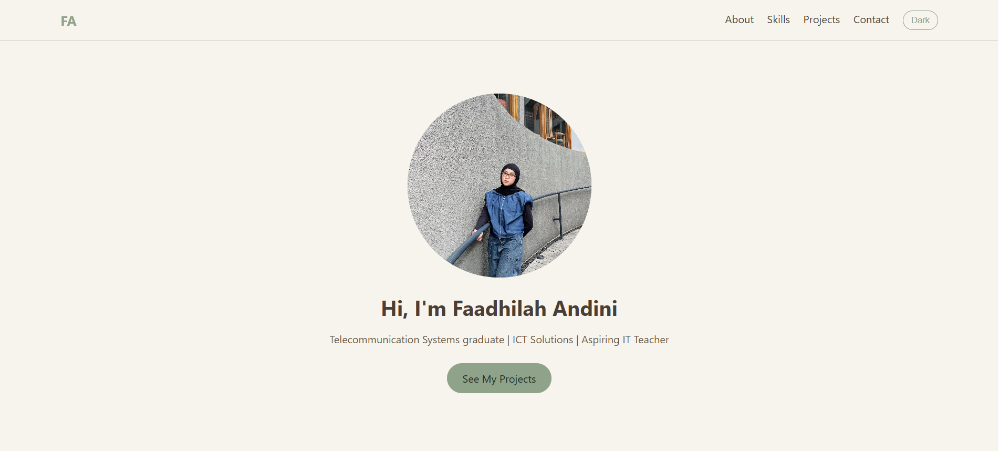

# Portfolio Website

A personal portfolio website to showcase my profile, skills, and projects.

**Live Demo:** (https://faadhila.github.io/portfolio-website/)

## Features
- Responsive layout with sections: About, Skills, Projects, Contact
- Dark/Light mode toggle
- Project filter by category (JavaScript)
- Scroll fade-in animation

## Technologies
- HTML
- CSS
- JavaScript

## How to Run Locally
1. Clone or download this repository.
2. Open `index.html` in your browser.

## Screenshot

## Author
Faadhilah Andini
